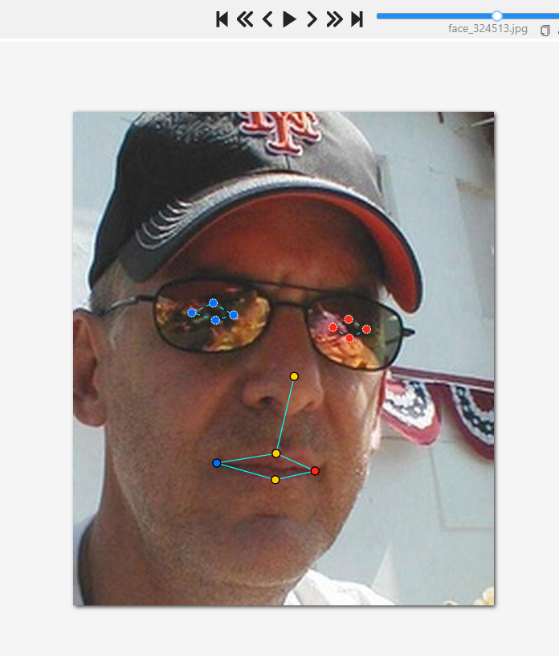

# Báo cáo cá nhân — PhamPhuNguyenHung-2A202604062

Dữ liệu: 12 ảnh người COCO val2017 (Lin et al., 2014) và 8 ảnh chân dung Wikimedia Commons, chỉ dùng trong lớp.

## 0. Thông tin học viên

- Họ tên: Phạm Phú Nguyên Hùng
- MSSV: 2A202604062
- Email: hungphamphunguyen@gmail.com
- Link repository: https://github.com/phamphunguyenhung/K5-L2B-DAY04-PhamPhuNguyenHung-2A202604062-KeypointPose
- Phiên bản CVAT (Help → About): 2.74.1 (đọc từ API /api/server/about)
- Máy: Windows 11 Pro · RAM 16 GB (Docker Desktop được cấp 7.7 GB) · chạy CVAT chế độ đầy đủ
- Bộ ảnh (`src/exports/assignment.json` do `lab.py setup` tạo): có
- Giờ bắt đầu:16:36
- Giờ kết thúc:17:22

## 1. Kiểm tra label (CP0)

| Label | Kiểu | Số điểm | Tên điểm đúng bảng của lab? | Đúng thứ tự? | Số cạnh |
|---|---|---:|---|---|---:|
| `person` | Skeleton | 17 | Có (kiểm bằng tool) | Có (kiểm bằng tool) | 19 |
| `face` | Skeleton | 13 | Có (kiểm bằng tool) | Có (kiểm bằng tool) | 13 |

Mẫu `person` dựng theo người quay mặt về camera (các điểm `left_*` nằm bên phải khung mẫu)? Có

Cách đổi cờ `occluded` / `outside` cho **một điểm** trên phiên bản CVAT này (một câu): outside O occluded Q

...

## 2. Số lượng đã gán và thời gian (CP1, CP2)

| Nhóm ảnh | Số ảnh | Số skeleton đã gán | Số người dưới 60 px (không gán) | Số poster / gương / màn hình bỏ qua | Thời gian (phút) |
|---|---:|---:|---:|---:|---:|
| `easy` | 5 | 5 | 0 | 0 | gộp trong CP1 (39) |
| `occluded` | 3 | 6 | 0 | 0 | gộp trong CP1 (39) |
| `back` | 2 | 4 | 0 | 0 | gộp trong CP1 (39) |
| `small` | 1 | 1 | 2 | 0 | gộp trong CP1 (39) |
| `crowd` | 1 | 3 | 0 | 0 | gộp trong CP1 (39) |
| `faces` | 8 | 8 | — | — | CP2 (45) |

- Số ảnh người đã xong ở mốc phút 105: 10 / 10
- Thời gian thực tế (phút): CP1 39 · CP2 45 · CP3 30 (phần này cần bạn ghi theo đồng hồ của mình, công cụ không đo được thời gian gán tay)
- Ảnh tốn thời gian nhất là `000000332273.jpg` (nhóm `crowd`): có 3 người, nhiều skeleton nhất, các người chồng lên nhau nên phải chỉnh nhiều điểm.

## 3. Bảng ca khó (CP1, CP2)

Mỗi điểm bạn phân vân một dòng, nhất là phân vân giữa `v = 1` và `v = 0`, hoặc không chắc hướng người.

| Ảnh | Người / mặt | Điểm | Cờ đã chọn | Phân vân giữa | Lý do chọn |
|---|---|---|---:|---|---|
| face_324513.jpg | Mặt (kính râm) | `left_eye_upper`, `left_eye_lower`, `right_eye_upper`, `right_eye_lower` | `occluded` (v = 1) | v = 1 / v = 0 | Tròng kính râm tối che mắt, không thấy con người. Đặt điểm mí theo vị trí ước lượng từ gọng kính và đường mắt, dùng phím Q để đặt điểm dự đoán. Chọn v = 1 vì vị trí ước lượng được tương đối chắc. |

## 4. Bảng tự review (CP3)

Đi từ ảnh cuối về ảnh đầu. 5 ảnh người (ít nhất 2 ảnh `back` hoặc `crowd`) và 3 ảnh mặt. Ít nhất 8 dòng, kể cả dòng `ok`. Ghi lỗi trước, sửa sau.

Mã lỗi dùng đúng một trong: `lr_swap`, `vis_flag`, `position`, `missing`, `extra`, `ok`.
không có lỗi phát hiện thêm, chỉ phát hiện sửa nhẹ phần ảnh 3 thôi

Tổng hợp số lỗi theo mã: 0

Điểm còn phân vân giữa `v = 1` và `v = 0` (ghi cả hai lựa chọn và lý do chọn):
kính râm ở job 13 lí do chọn v=1 là vì thầy bảo trong buổi học online và thực tế mình vẫn phải dự đoán chứ nó k phải nằm ngoài, 1 số cam hồng ngoại vẫn view đc
...

## 5. Kiểm file xuất và kết quả tự kiểm (CP4)

Tự kiểm trong file JSON (đọc bằng script: số phần tử, `num_keypoints`, giá trị `v`). Kiểm mắt thường các cảnh báo do người làm bài thực hiện.

| File | Người / mặt kiểm (ảnh, thứ tự) | Số phần tử `keypoints` | Điểm `outside` ra `v = 0`, `occluded` ra `v = 1`? | `num_keypoints` khớp? |
|---|---|---:|---|---|
| `PhamPhuNguyenHung_persons.zip` | 19 người, 12 ảnh (toàn bộ) | 51 | Có: v=0 có 9 điểm, v=1 có 32 điểm | Có (19/19) |
| `PhamPhuNguyenHung_faces.zip` | 8 mặt, 8 ảnh (toàn bộ) | 39 | Có: v=1 có 10 điểm, không có v=0 | Có (8/8) |

Sau khi xuất, CVAT ghi `occluded` thành `v = 1` và `outside` thành `v = 0`. Tọa độ của điểm `outside` trong file là tọa độ cũ, không phải `0, 0` (theo ghi chú của script: CVAT 2.x xuất như vậy, điểm `v = 0` bị bỏ qua khi huấn luyện và chấm).

Hai job đã chuyển sang completed trên CVAT? Có (stage `acceptance`, state `completed`, kiểm lại qua API). Đã export lại sau khi finish: số liệu không đổi.

Tóm tắt in ra từ `src/check_submission.py`:

```text
- File person: PhamPhuNguyenHung_persons.zip
  Số ảnh: 12 · số skeleton `person`: 19 · mỗi annotation 51 số
  Skeleton theo ảnh: 000000023424=2, 000000054909=2, 000000078170=2, 000000157271=2, 000000241837=1, 000000292999=1, 000000308257=1, 000000323705=1, 000000332273=3, 000000336477=1, 000000365099=1, 000000521817=2
  Cờ v: v=2 282 (87%) · v=1 32 (10%) · v=0 9 (3%)
  num_keypoints trung bình: 16.5
- File face: PhamPhuNguyenHung_faces.zip
  Số ảnh: 8 · số skeleton `face`: 8 · mỗi annotation 39 số
  Skeleton theo ảnh: face_105668=1, face_223746=1, face_300399=1, face_324513=1, face_342273=1, face_425647=1, face_575921=1, face_79367=1
  Cờ v: v=2 94 (90%) · v=1 10 (10%) · v=0 0 (0%)
  num_keypoints trung bình: 13.0
- Số [LỖI]: 0 · số [CẢNH BÁO]: 8
Kết quả: ĐẠT (đọc lại từng cảnh báo ở trên)
```

Các `[CẢNH BÁO]` và quyết định:

| Ảnh | Người | Cảnh báo | Quyết định | Lý do |
|---|---|---|---|---|
| 000000023424.jpg | #1, #2 | Mũi và hai mắt `v=2` nhưng các điểm `left` nằm bên trái ảnh (giống quay lưng) | Giữ nguyên | Đã kiểm tra bằng mắt: hướng người đúng |
| 000000054909.jpg | #1, #2 | Như trên | Giữ nguyên | Đã kiểm tra bằng mắt: hướng người đúng |
| 000000157271.jpg | #2 | Như trên | Giữ nguyên | Đã kiểm tra bằng mắt: hướng người đúng |
| 000000308257.jpg | #1 | Cặp ankle ngược phía các cặp còn lại | Giữ nguyên | Đã kiểm tra bằng mắt: chân bước bắt chéo |
| 000000332273.jpg | #3 | Cặp ankle ngược phía các cặp còn lại | Giữ nguyên | Đã kiểm tra bằng mắt: chân bước bắt chéo |
| 000000521817.jpg | #1 | Cặp ear và knee ngược phía các cặp còn lại | Giữ nguyên | Đã kiểm tra bằng mắt: vị trí đúng |

## 6. Ảnh chụp màn hình

1. Label `person` trong label constructor (đủ 17 điểm có tên):

   

2. Một người quay lưng đã gán, cờ đã đặt:

   

3. Một khuôn mặt đã gán 13 điểm, phóng to vùng mắt:

   

4. Một đoạn JSON xuất của một người:

   

Nguồn ảnh: COCO val2017 / Wikimedia Commons.

## 7. Tự đánh giá

1. Lỗi bạn mắc nhiều nhất hôm nay, và cách bạn sẽ tránh ở dự án thật:

   làm tay quá thủ công mà không dùng tools, và mình có thể copy trước các mẫu skeleton gần giống nhau để tăng tgian làm nếu làm tay

2. Một quy tắc bạn đề xuất thêm vào guideline (kèm ảnh ví dụ nếu có):

   làm quen được thao tác rồi thì làm 1 cách thông minh chứ không phải cố chấp tốn thời gian làm tay nếu thực sự mình không làm được thì hỏi AI và các giải pháp khác trên mạng để tăng quy trình không tự mày mò tốn tgian

3. Nhãn của bạn đi vào model ở đâu? Chọn một lỗi bạn đã sửa và nói nó sẽ làm model học sai thế nào (heatmap, trọng số trong loss, hay bước lật ảnh):
Ở Job 13, ảnh số 3, tôi kiểm tra lại và sửa nhãn visibility của các điểm mắt từ v=2 (nhìn thấy rõ) sang v=1 (bị che khuất) bằng phím Q, vì mắt bị kính râm che. Nếu giữ v=2, model sẽ học sai trọng số trong loss, coi các điểm mắt ước lượng là điểm nhìn thấy rõ, làm giảm độ chính xác khi dự đoán landmark.

## 8. Khó khăn và lỗi kỹ thuật

- Docker Desktop chưa chạy khi bắt đầu `lab.py check`: đã mở Docker Desktop, sau đó check OK.
- `lab.py setup` cần đăng nhập tương tác: đã đưa tài khoản vào file `.env` (không commit) và nạp biến môi trường trước khi chạy.
- Tải model `yolo11l-pose` bị ngắt ở 99%: đã chạy tải lại thành công.

## Bonus (nếu làm)

Không làm phần bonus.

## 9. Tài liệu tham khảo và công cụ AI đã dùng

- Model pose local `yolo11l-pose` (Ultralytics YOLO11, pretrained COCO) để sinh nháp skeleton người. Chạy trên CPU.
- OpenCV Haar cascade (dự phòng khi không có điểm mắt-mũi để neo nháp mặt).
- Công cụ tự viết `tools/skeleton-pose-manager` để sinh nháp, ghi lên CVAT có backup, và kiểm tra cấu trúc. Dữ liệu không rời máy.
- AI (Claude Code) dùng để viết code của công cụ trên. Mọi quyết định gán nhãn, cờ visibility, và nội dung mục 3, 4, 7 do người làm bài thực hiện.
- Số liệu nháp: người 323 điểm (job 12), mặt 104 điểm (job 13). Số điểm đã chỉnh tay (so với nháp, đo bằng `spm diff`): người 25/221 điểm lệch hơn 3 px, 33 điểm đổi cờ; mặt 84/104 điểm lệch hơn 3 px, 10 điểm đổi cờ.
